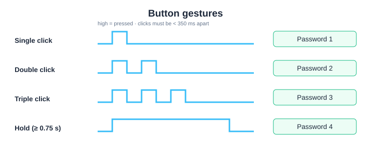
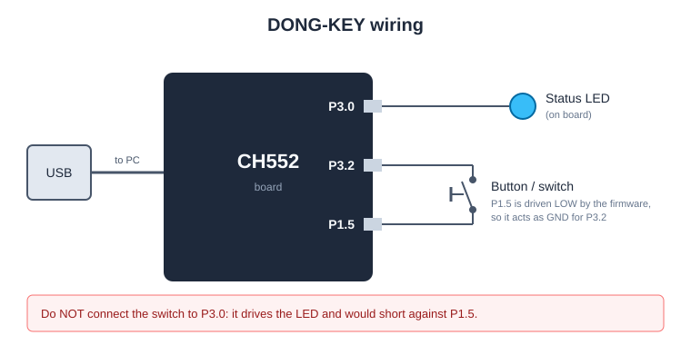

# DONG-KEY

A one-button USB password typer built on the **CH552** microcontroller.
Store up to 4 passwords (80 characters in total) on the device, then type them into any PC with a click.
No driver or software is needed on the PC where you type; the device shows up as a normal USB keyboard.



| Gesture | Types |
|---|---|
| Single click | Password 1 + Enter |
| Double click | Password 2 + Enter |
| Triple click | Password 3 + Enter |
| Hold ≥ 0.75 s | Password 4 + Enter |

---

## Download

Get the configurator for Windows from the **[Releases page](../../releases/latest)**:
download `DongKey-Configurator-vX.Y.zip`, unzip it, and run `DongKey-Configurator.exe`.

> **Windows SmartScreen warning.** The `.exe` is not code-signed, so Windows may show
> *"Windows protected your PC"*. Click **More info → Run anyway**.
> You can check the file is the original by comparing its SHA-256 hash with the one in the release notes:
> `certutil -hashfile DongKey-Configurator-vX.Y.zip SHA256`

---

## Setting the passwords

1. Plug in the DONG-KEY.
2. Open the configurator, click **Open Settings Panel**, and pick the device's COM port (**🔄 Scan** if it isn't listed).
3. The current passwords load automatically (or click **📖 Read Layout**).
4. Type the new passwords and click **Update Device**. Wait for *"saved to CH552"*.

<!-- Add a screenshot of the configurator here, e.g.:
 -->

**Allowed characters:** standard ASCII only (letters, digits, space and
``! " # $ % & ' ( ) * + , - . / : ; < = > ? @ [ \ ] ^ _ ` { | } ~``).
Accented letters, `£ €`, emoji and "smart quotes" are rejected.

**Keyboard layout:** the device types using the **US English** keyboard layout.
On other layouts (UK, German, French, Arabic…), symbols such as `@ " # \ | ~` may come out wrong.

---

## Status LED

| LED | Meaning |
|---|---|
| Slow blink (1 s) | Ready, stored passwords are valid |
| Fast blink | Stored data is invalid (e.g. an update was interrupted). Re-enter all 4 passwords and click **Update Device** |
| 3 quick flashes after a click | Refused to type because the slot is invalid |

The device never types a password it can't verify, and an interrupted update never leaves a half-written password behind.

---

## Hardware



- **CH552** board with USB.
- **Button:** between **P3.2** and **P1.5**. The firmware drives P1.5 LOW after start-up, so it acts as ground for the button.
  A button from P3.2 to GND also works.
- **Status LED:** on **P3.0**.
- If the switch is already closed when the device is plugged in, it is ignored until released,
  so plugging in never types anything by accident.

---

## Building the firmware

1. Install the [Arduino IDE](https://www.arduino.cc/en/software).
2. **File → Preferences → Additional boards manager URLs**, add:
   ```
   https://raw.githubusercontent.com/DeqingSun/ch55xduino/ch55xduino/package_ch55xduino_mcs51_index.json
   ```
3. **Tools → Board → Boards Manager**, install **CH55xDuino MCS51 plain C core**.
4. Open `firmware/makropad_4/makropad_4.ino` and set:
   - **Board:** CH552 Board
   - **USB Settings:** **USER CODE w/ 266B USB ram**
5. Upload. For the very first upload the CH552 must be in bootloader mode (see your board's instructions);
   after that the IDE can upload normally over USB.

> Keep `src/CdcHidCombo/` next to the `.ino` file, and keep only **one** `.ino` file in the folder;
> the Arduino IDE compiles every `.ino` in a sketch folder together.

## Building the configurator `.exe`

On Windows with Python 3:

```bat
cd configurator
build_exe.bat
```

This installs `pyserial` and PyInstaller, builds `DongKey-Configurator.exe`,
and puts `DongKey-Configurator-v1.0.zip` plus its SHA-256 hash in `configurator\release\`.
Upload that zip to a GitHub Release.

To run from source instead: `pip install -r requirements.txt` then `python Magicbutton4.py`.

---

## Repository layout

```
firmware/makropad_4/
├── makropad_4.ino            device firmware
└── src/CdcHidCombo/          USB serial + keyboard driver (from the ch55xduino examples)
configurator/
├── Magicbutton4.py           PC configurator (Python / tkinter)
├── requirements.txt
└── build_exe.bat             builds the Windows .exe and release zip
docs/                         diagrams used in this README
```

## Security note

Passwords are stored **unencrypted** in the CH552's DataFlash. Anyone holding the device can read them
with the configurator. Treat the DONG-KEY like a written-down password and keep it with you.

## Credits

Created by **Dani Madya A.S.**

The USB CDC + HID keyboard driver in `src/CdcHidCombo/` comes from the
[ch55xduino](https://github.com/DeqingSun/ch55xduino) examples by Deqing Sun; see that project for its license.
